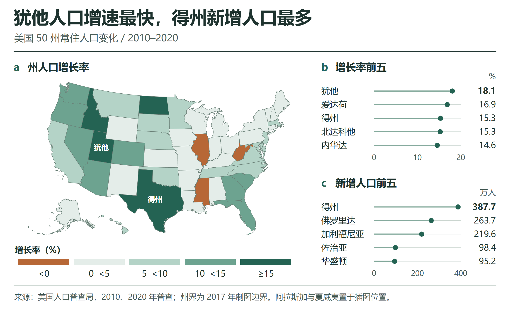

# Wallace Draw · 科研绘图工作台

这里维护四个可安装的绘图 skill，覆盖从零设计科研图、复刻方法框架、空间与统计结果组图、规划用地制图。

这张图的主问题是“增长最快”和“增加最多”是否指向同一州。地图展示 50 州，右侧以两个单位分别排序。犹他州增长约 18.1%，得州增加约 387.7 万人。[可编辑 SVG](examples/population-change.svg) · [数据与复现](skills/design-spatial-data-figures/references/census-example.md)

## 从这里开始

| 手头的任务 | 入口 | 交付物 |
|---|---|---|
| 从零画方法、系统、技术路线 | [科研组合图](skills/compose-hybrid-scientific-figures/SKILL.md) | 依据研究依赖选择分叉、汇合、泳道或局部放大，先做效果图，再替换真实工件 |
| 根据参考图精确重建 | [draw.io 复刻](skills/drawio-scientific-illustrator/SKILL.md) | 在实时画布还原几何、拓扑和版式，导出可编辑母版；需另有 draw.io live MCP |
| 从数据绘制地图和统计大图 | [空间与统计组图](skills/design-spatial-data-figures/SKILL.md) | D3 地图与排名实例，以及接收自有 CSV 和可选边界的配对比较绘图脚本 |
| 地块用地现状与面积结构 | [用地制图](skills/urban-landuse-mapping/SKILL.md) | 边界裁剪、分类、面积占比、专题图和核对表 |

需要描述风格时，可以直接说“主图用同范围小多图对照两个半径，右侧用配对点图显示同一街道的变化，两个图只标识同一组反转街道”。如果只给研究问题，skill 会自行提出两种构图，说明选择并继续出图。[视觉词汇与六个开源实例](skills/design-spatial-data-figures/references/visual-vocabulary.md) · [原创方法图设计示例](skills/compose-hybrid-scientific-figures/references/original-framework.md)

## 来源与本地经验

| 能确认的来源 | 在本机的角色 |
|---|---|
| [K-Dense scientific-visualization](https://github.com/K-Dense-AI/scientific-agent-skills/tree/main/skills/scientific-visualization) | 本机科学工具包下的模块有 K-Dense 作者字段；与 Matplotlib、Seaborn 等按需配合，用于出版导出、统计标注、色彩和可读性 |
| [nature-figure 的本地检出版本](https://github.com/Yuan1z0825/nature-skills/tree/cad6fe4b0332ba5a9039385e88b9a4d7b9a58ef8/skills/nature-figure) | 在论文项目的外部技能目录内可核实；可作证据层次与多面板设计的参考。现有材料不足以把自定义 skill 的具体段落逐一归到该项目 |
| [Ye 等，2025](https://doi.org/10.1016/j.scs.2025.106503) | 这是经过本地拆解的论文版式案例。保留了热斑图组的结构分析，作为可选模板 |
| 自定义组合图、实时 draw.io 和土地利用制图 | 保留了先做效果图、实证图回到数据源、保留选定插画及裁切记录、研究树父子边、版式叠图校验、最终栏宽检查等经验 |
| [D3](https://github.com/d3/d3)、[Observable Plot](https://github.com/observablehq/plot)、[US Atlas](https://github.com/topojson/us-atlas) | 本轮引入的设计案例与地图依赖。示例实际运行 D3 和 TopoJSON，Plot 提供分面和统计标记参考 |

原有三个自定义 skill 的导入快照保存在 Git 历史。科学工具包与上游外部项目按作者来源引用，仓库只维护本地绘图流程。论文项目中的一次性重绘脚本另由项目管理。

## 安装与同步

要求 Python 3.10+ 和 Git。克隆本仓库并进入其目录：

~~~sh
python scripts/sync_skills.py check
python scripts/sync_skills.py apply
python scripts/sync_skills.py check
~~~

`apply` 将 Git 索引中的绘图文件与用户目录 `~/.claude/skills`（自定义源）、`~/.agents/skills`（发现镜像）同步。初次安装要求同名现有文件与仓库相容。后续根据上次同步内容辨认单侧修改，遇到相互冲突、删除或未登记文件时列出路径供处理。同步基线只存于本地 Git 元数据。只需安装一个 skill 时，也可以将相应子目录复制到自己的 skills 路径。

**本机维护约定。** 每次完成绘图 skill 修改后，进入本仓库，审阅差异与新增资源，执行 `apply`、验证和 `check`。将本次改动提交并推送至 `origin/main`，核实远端提交。新文件先按明确路径加入仓库索引。若是手工编辑，以上命令及 Git 提交推送可直接复用。详细流程见 [维护约定](AGENTS.md)。
